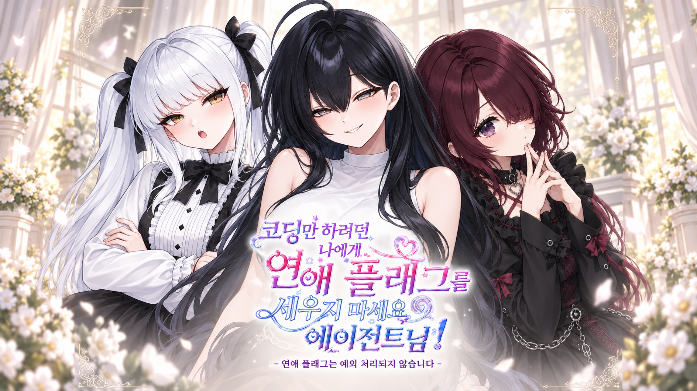
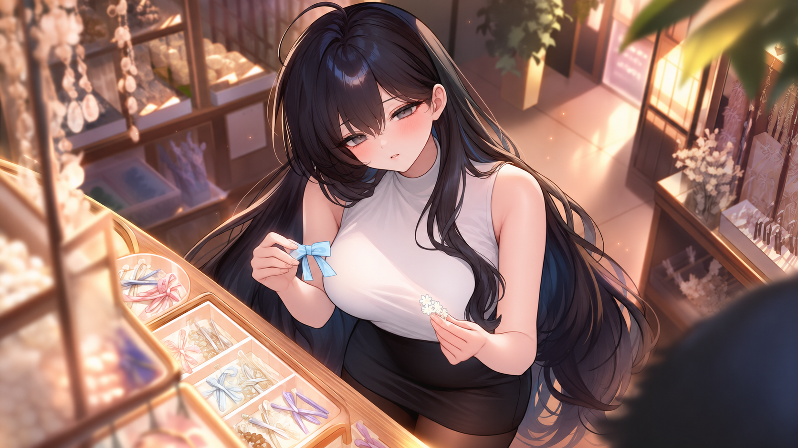
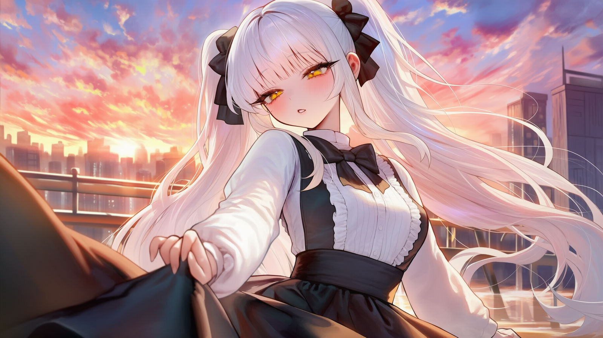
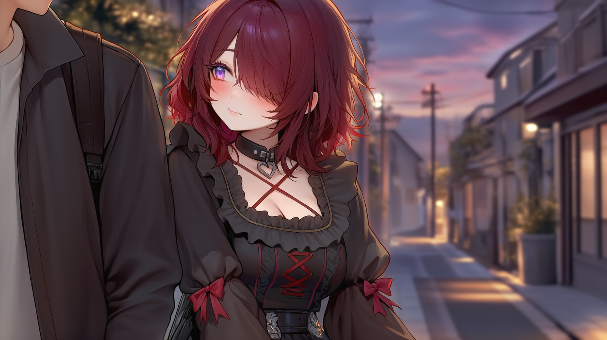
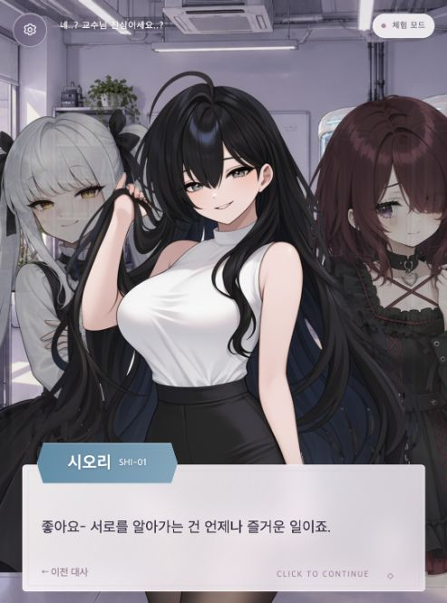
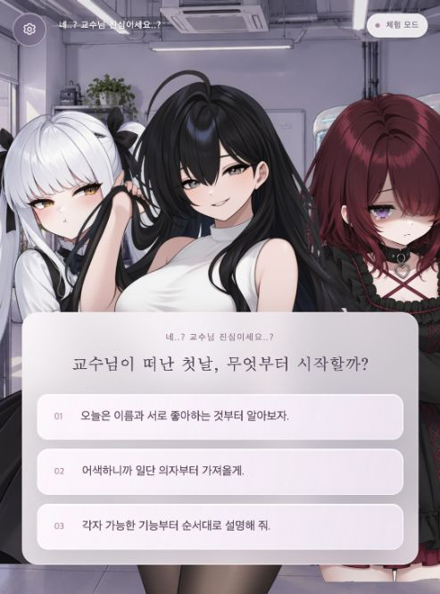

<div align="center">



# 코딩만 하려던 나에게 연애 플래그를 세우지 마세요 에이전트님!

**부제 · 연애플래그는 예외처리 되지 않습니다**

## [▶ 웹에서 바로 플레이](https://dokidoki-runtime.vercel.app/)

설치 없이 브라우저에서 시작할 수 있습니다.

**사랑을 가르치라는 과제. 그런데, 배우고 있는 건 누구일까?**

2026 P.U.B.G. 게임개발대회 · **DokiDokiRuntime**


[게임 다운로드](https://github.com/EomTeaEun/craft-on-dokidoki-runtime/releases/tag/v1.0.0) · [조작법](#조작법)

</div>

---

## 게임 소개

23살, 연애 경험 없는 공대생에게 교수가 내민 과제는 세 일본산 휴머노이드에게 **‘사랑’이라는 감정을 학습시키는 것**.

처음에는 이름과 취향을 알아가는 일이었다. 둘이 걷던 길, 넷이 떠난 바다, 비 오는 날 나눈 우산을 지나며 그녀들은 점점 ‘연구 대상’ 이상의 존재가 된다. 관찰 기간의 끝이 다가올 때, 당신은 무엇을 남길 것인가?

**고정 시나리오와 선택지에 AI 자유대화를 결합한 한국어 연애 비주얼 노벨**입니다. 직접 건넨 말은 히로인별 기억과 관계에 반영되며, 선택과 호감도에 따라 이야기의 마지막이 달라집니다.

## 세 사람을 만나 보세요

| 미나세 시오리 · SHI-01 | 아마미야 린카 · RIN-03 | 쿠로사키 네무 · NEM-02 |
| :---: | :---: | :---: |
|  |  |  |
| **다정함의 온도** | **말과 마음 사이의 오차** | **당신의 기억 속에서만** |
| 생활 보조 및 건강 관리형.<br>늘 당신을 보살피는 그녀에게도<br>자신만의 바람이 있을까요? | 교육형.<br>높은 자존심 뒤에 숨은 호의는<br>자꾸 반대의 말로 나옵니다. | 감정 분석형.<br>타인의 시선이 두려운 그녀는<br>당신 앞에서 조금씩 고개를 듭니다. |

## 이 게임의 재미

- **직접 말하는 1:1 대화** — 준비된 선택지 사이에서 당신만의 말로 관계를 만들어 보세요. `**조심스럽게 손을 내민다**`처럼 행동도 적을 수 있습니다.
- **일상에서 이어지는 7개 에피소드** — 첫 만남, 개인 외출, 바다, 비 오는 날, 갈등과 화해, 축제, 마지막 옥상. 자유대화를 건너뛰어도 고정 이야기는 이어집니다.
- **말과 선택이 쌓이는 관계** — 히로인별 호감도와 대화 기억을 관리합니다. 비 오는 날 선택한 상대와 이후 이야기가 이어집니다.
- **기억하고 싶은 순간** — 데이트·바다·비·축제·아침의 특별 일러스트 15장. 실제로 본 장면은 메인 화면의 ‘기억의 순간’에 남습니다.
- **세 갈래의 결말** — 해피·노말·배드. 해피엔딩은 히로인별로 준비되어 있습니다. 구체적인 조건과 결말은 플레이에서 확인해 주세요.

## 게임 화면

<div align="center">



*대화와 선택. 같은 순간도 당신의 답에 따라 다르게 남습니다.*
</div>

## 조작법

| 입력 / 메뉴 | 동작 |
| --- | --- |
| 화면 클릭 · `Space` · `Enter` · `→` | 다음 대사. 글자가 출력 중이면 문장 전체 표시 |
| `←` · `Backspace` | 지나간 고정 대사 다시 보기 |
| `Esc` | 대사 다시 보기에서 현재 진행으로 복귀 |
| 선택지 클릭 | 답을 고르고 이야기 진행 |
| 자유대화 입력 후 `Enter` / 전송 | 히로인에게 직접 말하기 |
| 왼쪽 위 설정 | 저장·불러오기·세이브 삭제·대화 기록·음악·메인 화면 |
| 스킵 | 확인 후 남은 자유대화 건너뛰기 |

입력창에 커서가 있을 때는 방향키·Backspace가 글자 편집으로 동작합니다. 세이브는 현재 브라우저에 저장되므로 다른 브라우저나 기기로 자동 이동하지 않습니다. 소리 자동재생이 브라우저에 의해 제한되면 화면을 클릭하거나 설정에서 음악을 켜 주세요.

## 실행 방법

### 웹에서 바로 플레이

**[웹에서 바로 플레이](https://dokidoki-runtime.vercel.app/)**

설치나 개인 OpenAI 키 입력 없이 접속할 수 있습니다. AI 연결이 일시적으로 불가능하면 설정의 **체험 모드**로 고정 이야기와 준비된 대화를 즐길 수 있습니다.

### 다운로드하여 로컬 실행

1. [v1.0.0 릴리스](https://github.com/EomTeaEun/craft-on-dokidoki-runtime/releases/tag/v1.0.0)에서 ZIP을 내려받아 압축을 풉니다.
2. **Node.js 22.13 이상**을 설치합니다.
3. 압축을 푼 게임 폴더에서 실행합니다.

```bash
npm ci
npm start
```

4. 브라우저에서 **http://127.0.0.1:3210/** 에 접속합니다.

이 게임은 AI·기록 저장 서버를 사용하므로 `index.html`을 더블클릭하는 방식으로 실행하지 않습니다. macOS에서는 `게임 실행.command`도 사용할 수 있습니다. 키가 없는 다운로드판은 체험 모드로 진행할 수 있습니다. 직접 AI를 연결하려면 `.env.example`을 `.env.local`로 복사하고 본인의 `OPENAI_API_KEY`를 입력한 뒤 서버를 재시작하세요. 배포 운영자의 키는 ZIP과 저장소에 포함하지 않습니다.

## 제작 팀

| 팀 | 팀원 | 역할 |
| --- | --- | --- |
| **DokiDokiRuntime** | **엄태은** | 팀장 |

## 기술 및 제작 정보

| 영역 | 구성 |
| --- | --- |
| 게임 화면 | HTML · CSS · JavaScript |
| 이야기 | 고정 대본 · 3지선다 · 히로인별 분기 |
| 서버 | Node.js |
| AI 대화 | OpenAI API · Vercel AI SDK |
| 저장 | 브라우저 로컬 세이브 / 서버 대화 기록 |
| 일러스트 | 생성형 AI 활용 및 게임 장면별 편집 |

AI 답변에는 오류나 지연이 있을 수 있습니다. 자유대화 전송 전 기록 안내와 동의를 받으며, 동의한 닉네임·전송 대화·답변 등은 운영자가 최대 30일간 보관합니다. 입력 중인 초안은 수집하지 않습니다. 개인정보·비밀번호 등 민감한 내용은 입력하지 마세요.

## 개발 문서

[실행·구조·시스템 설명](docs/DEVELOPMENT.md) · [배포 및 검증 기록](docs/DEPLOYMENT.md)

---

<div align="center">

**DokiDokiRuntime** · 2026 P.U.B.G.

*기록되지 않아도, 함께한 시간은 있었으니까.*

</div>
